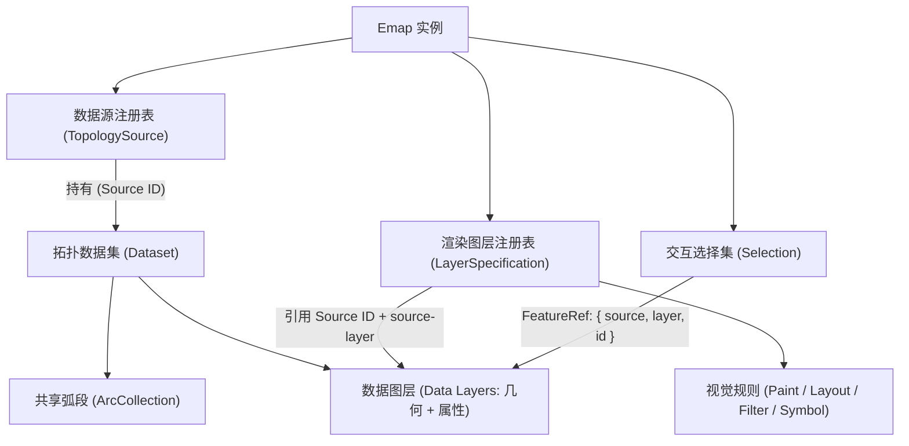

# 地图与数据模型 {#核心概念}

Emap 的核心设计是将**底层空间数据（Source & Dataset）**、**视觉呈现配置（Render Layer）**和**交互编辑状态（Selection & History）**三者解耦。理解这一分层模型后，你不仅可以让多个渲染图层零拷贝地共享同一份拓扑几何，还能在修改顶点或属性时获得受控的撤销与重做能力。

## 1. 核心对象关系与数据流向

在一张运行中的 Emap 地图里，核心对象按以下层级协作：

- **`Emap`（地图门面实例）**：应用层的主入口，协调数据源注册表、相机视口、图层渲染器、交互 Handler 与历史栈。
- **`TopologySource`（拓扑数据源）**：以唯一的数据源 ID 注册到地图，内部持有拓扑数据集（Dataset）；一个数据集包含共享弧段集合（`ArcCollection`）以及一个或多个**数据图层（Data Layers）**，每个数据图层保存几何形状与对应的属性表。
- **`LayerSpecification`（渲染图层声明）**：纯视觉规则配置，通过 `source`（数据源 ID）和可选的 `source-layer`（数据图层名称）指向底层数据，声明如何将其绘制为面填充（`fill`）、线（`line`）或圆点（`circle`）。
- **`Selection`（选择集）**：通过 `{ source, layer, id }` 构成的要素引用（`FeatureRef`）定位数据图层中的具体要素。

这种解耦带来的直接好处是：**同一个多边形数据图层可以同时被一个 `fill` 填充渲染层和一个 `line` 描边渲染层引用**。调用 `map.removeLayer()` 只会移除某一种视觉样式，不会删除底层数据；而移除或替换 `TopologySource` 则会直接改变所有引用它的渲染图层的数据可用性（详见[数据源与图层](./source-layer.md)）。

## 2. 坐标空间与要素身份标识

在编写交互与查询逻辑时，需要明确区分两类坐标系与两类 ID：

1. **项目坐标 vs. 画布像素坐标**：数据源中的几何顶点与相机的 `center` 均处于当前地图的**项目坐标系（Project CRS）**中；而鼠标指针事件与屏幕绘制则使用相对于画布左上角的 **Canvas 像素坐标**。`map.project()` 与 `map.unproject()` 仅负责在“当前项目坐标”和“Canvas 像素”之间做视图矩阵换算；真正的跨坐标系重投影由 `await map.reproject(targetCrs)` 或 `map.ops.projectLayer()` 执行（详见[坐标与 CRS](./coordinates-crs.md)）。
2. **运行时要素索引（`FeatureRef.id`）vs. 持久业务主键**：要素引用 `{ source, layer, id }` 中的 `id` 是该要素在当前数据图层数组中的位置索引（从 `0` 开始），并不是业务数据库里的永久 UUID。当执行删除、合并、筛选或 `setData()` 替换后，数组索引会发生变化。若业务面板需要跨操作持久追踪某个要素，请将业务主键存放在要素的 `properties` 属性字段中，并在数据变更后重新查询定位。

## 3. 状态修改的职责边界

不同种类的状态变更有着严格分离的 API 入口：

- **只改画面外观**：使用 `setPaintProperty()`、`setLayerVisibility()` 或图层 `filter`。它们立即触发重绘，但绝不改动底层数据集，也不进入编辑历史栈。
- **只改交互反馈**：使用 `map.select()`、`map.clearSelection()` 或高亮管理器（`HighlightManager`）。
- **可逆修改空间数据**：使用交互编辑 Handler、`map.editSession`、`map.attributes` 或 `map.ops`。这些入口会通过编辑命令（`EditCommand`）或操作运行器递增数据源版本号、同步刷新所有关联渲染层，并将变更记录到撤销/重做历史栈中。

> **只读契约警告**：调用 `source.getDataset()`、`source.getLayers()` 或 `map.features.get()` 返回的对象均为**只读实时视图或冻结快照**。请勿直接篡改底层数组或属性对象，否则会绕过版本号追踪与历史管理导致渲染状态失步。需要将修改后的数据持久化到磁盘或服务端时，请调用 `await source.export()`（详见[导入与导出数据格式](../data/formats.md)）。

## 4. 运行时扩展与资源所有权

每张 `Emap` 地图实例内部都运行着一个独立的原生 Cordis 上下文（`map.ctx`）。创建地图时指定的 `preset`（如默认的 `'editor'`、不含交互式编辑 Handler 的 `'viewer'` 或无画布的 `'headless'`）决定了默认装配哪些服务与功能插件；`viewer` 仍保留数据处理能力，并非只读权限边界。插件内部的 `Fiber` 与 `ctx.effect()` 负责管理事件订阅、DOM 控件及后台资源的自动释放。如果应用将外部创建的共享 `workerRuntime` 传给地图，该运行时属于借用资源，需在所有消费地图销毁后由宿主应用负责释放。

接下来你可以继续阅读：

- [Emap 地图实例](./emap.md)：掌握地图创建、方法分类与 `dispose()` 销毁生命周期。
- [运行时组成](./runtime.md)：理解 Cordis 服务契约、Preset 差异与插件依赖树。
- [操作指南总览](../guides/index.md)：按具体功能模块查阅集成步骤。

## 可运行示例

- [打开矢量文件](/mapseekai/emap/examples/getting-started/vector-file/)

## 实现依据

- [`src/engine/map/map.ts`](https://github.com/mapseekai/emap/blob/master/src/engine/map/map.ts)
- [`src/domain/source/source.ts`](https://github.com/mapseekai/emap/blob/master/src/domain/source/source.ts)
- [`src/runtime/presets/index.ts`](https://github.com/mapseekai/emap/blob/master/src/runtime/presets/index.ts)
