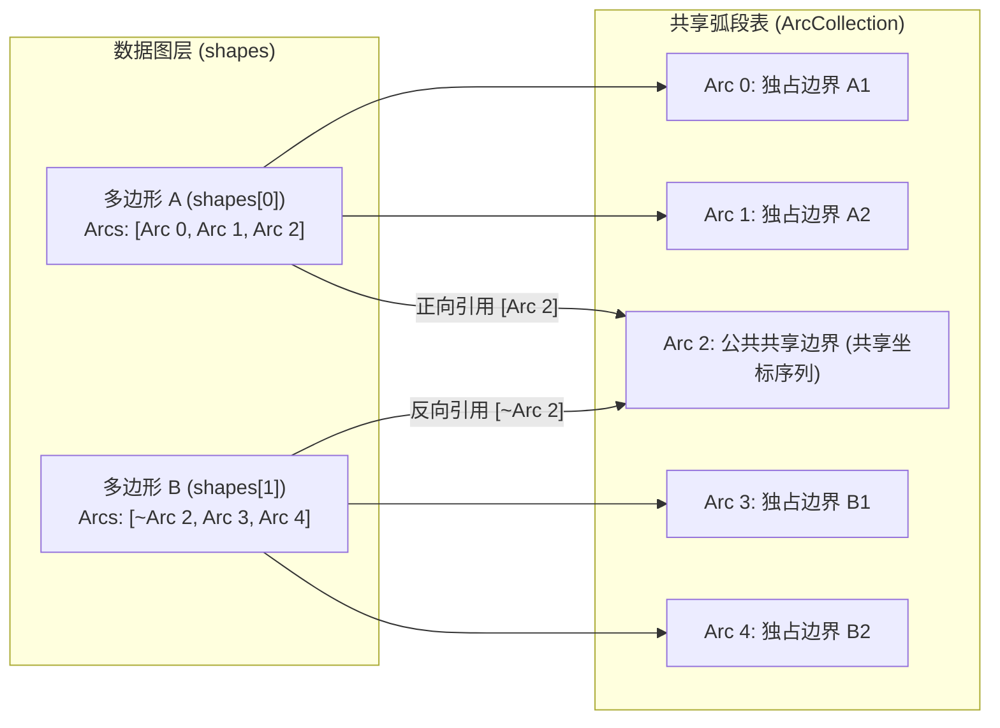

# 共享弧段与拓扑模型

与将每个多边形独立保存为坐标数组的传统渲染器不同，Emap 采用**共享弧段拓扑（Mapshaper 拓扑结构）**存储线和面要素：两个相邻行政区或地块的公共边界在底层只保存为一条共享弧段（Arc），两侧多边形通过有符号弧段索引共同引用这段边界。这种设计不仅消除了冗余坐标，还让“共边同步编辑”和“保持拓扑不裂缝的快速几何简化”成为原生能力。

## 1. Dataset 内部的拓扑几何结构

在一个 `TopologySource` 持有的 `MapshaperDataset` 中，空间数据由三个核心部分组成：

1. **共享弧段表（`ArcCollection`）**：集中存储所有折线与多边形环的顶点坐标序列。
2. **数据图层列表（`layers`）**：每个图层包含几何形状数组（`shapes`）与属性表（`data`），二者按要素索引严格对齐（即使某个要素是空几何 `null`，其对应位置的属性记录依然保留）：
   - **点要素（Point）**：直接在 `shapes` 中保存 `[x, y]` 坐标对数组，不经过弧段表。
   - **线与面要素（Path）**：由一个或多个路径部件（Part / Ring）组成，每个部件是一串有序的**有符号弧段 ID（`SignedArcId`）**。非负整数 `arcId` 表示正向遍历该弧段，负数 `~arcId`（按位取反）表示反向遍历同一条弧段。
3. **数据集元数据（`info`）**：记录坐标系（CRS）与导入源信息。

你可以通过 `TopologySource` 的只读访问器查看这些结构（日常业务查询通常直接使用 `map.features`，无需手动解码按位取反的弧段索引）：

```ts
const dataset = source.getDataset();
const layers = source.getLayers();
const arcs = source.getArcs();
console.log(layers.length, arcs?.getPointCount?.(), dataset?.info);
```

> **只读视图约定**：`getDataset()`、`getLayers()` 和 `getArcs()` 暴露底层数据的只读引用，不会深拷贝整份坐标数组。切勿直接修改返回对象内部的数组；原地编辑可能改变已有引用的内容，而数据集被替换后，旧引用也可能不再指向当前数据。需要最新状态时请重新读取，不要把这些引用当作历史快照。

## 2. 共享边界对几何编辑的影响



理解共享弧段对于设计编辑交互至关重要：

- **顶点编辑（共边联动）**：当一条弧段同时被地块 A 和相邻的地块 B 引用时，直接移动该弧段上的某个顶点，地块 A 和地块 B 的公共边界会**同步变形**，中间绝不会产生裂缝（Sliver）或重叠。
- **要素整体变换（默认拆分共享弧段）**：当用户只选中了地块 A 并执行整体平移、旋转或缩放时，通常不希望未选中的邻居地块 B 被一起扯变形。因此，变换会话默认开启 `splitSharedArcs: true`，在移动前先自动将地块 A 与未选中邻居之间的共享弧段拆开；如果你明确希望移动选中地块时牵引相邻地块边界一起变形，可以将 `splitSharedArcs` 显式设为 `false`（详见[编辑几何与管理事务](../guides/editing.md)）。

## 3. 重建拓扑关系（`rebuildTopology`）

当从外部追加了非拓扑几何、合并了多个独立图层或执行了批量坐标变换后，原本重合的边界可能尚未建立共享引用。此时可以调用 `map.ops.rebuildTopology()` 重新识别节点交点并构建共享弧段：

```ts
const result = await map.ops.rebuildTopology({ source: 'districts', noSnap: true });
if (!result.ok) console.error(result.error);
```

- **`noSnap: true`**：仅对坐标完全相等的顶点建立拓扑连接，跳过距离吸附预处理。
- **使用 `snapInterval` 吸附微小的数字缝隙**：如果源数据存在微小的数字化误差，可以指定 `snapInterval`（单位为当前数据源 CRS 的坐标单位）。注意：过大的吸附容差可能会把原本正常的狭窄通道或小短边合并塌缩，建议结合数据集精度谨慎设置，并在执行后通过几何检查（`checkGeometry`）与撤销历史验证效果。

## 4. 区分渲染级显示 LOD 与数据级拓扑简化

由于 `ArcCollection` 可以为每个顶点记录简化阈值（Z-value），Emap 支持极快的动态简化，但请务必区分以下两个层次：

1. **显示弧段 LOD（`geometryLod`）**：渲染器在绘制每一帧时，根据当前相机缩放比例和屏幕像素容差动态跳过密集顶点。它**完全不修改**原始坐标、属性或导出结果。
2. **数据操作简化（`map.ops.simplifyLayer()`）**：计算并修改数据集当前的简化保留阈值，**会影响后续的空间分析、编辑和文件导出**。原始弧段顶点仍保存在集合中，但仅关闭渲染器的 `geometryLod` 不会改变数据级阈值；可通过撤销或重新设置简化阈值调整该状态（更多性能与精度控制见[定位和改善性能](../recipes/performance.md)）。

## API

<span id="核心结构" />
<span id="更多只读查询" />
<span id="编辑与共享边界" />
<span id="渲染与数据简化" />

- [TopologySource](/mapseekai/emap/api/classes/emap.TopologySource.html)
- [MapshaperDataset](/mapseekai/emap/api/interfaces/emap.MapshaperDataset.html)
- [ArcCollection](/mapseekai/emap/api/interfaces/emap.ArcCollection.html)

## 可运行示例

- [重建拓扑](/mapseekai/emap/examples/rebuild-topology/)
- [顶点编辑](/mapseekai/emap/examples/vertex-editing/)
- [简化](/mapseekai/emap/examples/simplify/)

## 实现依据

- [`src/domain/source/topology-source.ts`](https://github.com/mapseekai/emap/blob/master/src/domain/source/topology-source.ts)
- [`src/domain/source/source.ts`](https://github.com/mapseekai/emap/blob/master/src/domain/source/source.ts)
- [`src/engine/map/types.ts`](https://github.com/mapseekai/emap/blob/master/src/engine/map/types.ts)
