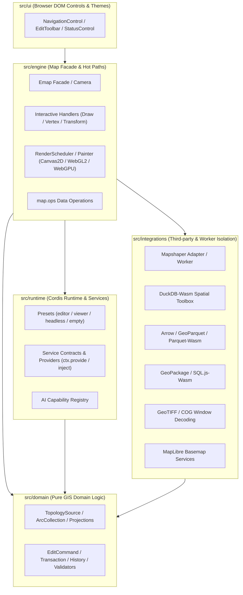

# Source organization

The `@mapseekai/emap` codebase separates pure domain logic, rendering and execution engines, Cordis runtime composition, and third-party library integrations into explicit directory boundaries. When reading or modifying the engine, identify the owning layer first and trace service contracts to their concrete providers.

## Directory responsibilities and dependency boundaries

| Directory | Primary responsibility | Dependency boundary |
| --- | --- | --- |
| `src/domain` | Geometry, projections, `TopologySource`, reversible `EditCommand`s, transactions, and validators | Pure domain logic; independent of Cordis, DOM controls, and concrete rendering backends |
| `src/engine` | `Emap` facade, camera, pointer/feature event dispatch, interaction handlers, painters, and `map.ops` | High-frequency execution paths |
| `src/runtime` | Cordis service contracts, providers, feature plugins, presets, and AI capability registry | Dependency wiring and lifecycle management |
| `src/integrations` | Isolated bridges for Mapshaper, Arrow/Parquet, DuckDB-Wasm, luma.gl/GPU, GeoPackage, GeoTIFF, and MapLibre | Encapsulates third-party libraries and Worker protocols |
| `src/ui` | DOM controls (`NavigationControl`, `EditToolbar`, etc.), themes, and icons | Browser UI presentation |
| `src/shared` | Cross-layer utility types and ambient declarations | Zero runtime side effects |

`src/index.ts` defines the root package exports, while `package.json` `exports` declares supported subpath entry points (`/arrow`, `/duckdb`, `/geopackage`, `/geotiff`, `/maplibre`, `/context`, `/services`, `/providers`, `/plugins`, `/presets`, `/ai`). Internal files outside declared package exports are not public API contracts.

## Data, editing, and rendering flow

1. **Workspace state**: Document, source, and layer services manage registered `TopologySource` instances and `LayerSpecification` entries.
2. **Frame scheduling and drawing**: Camera transforms and style expressions determine what is visible. The render scheduler coalesces state invalidations into animation frames and delegates drawing to the active `Painter` (`canvas2d`, `webgl2`, or `webgpu`).
3. **Versioned mutations**: Interactive handlers, edit sessions, and `map.ops` mutate data through commands and transactions that increment data/attribute versions and record `EditHistory`. Asynchronous Worker or DuckDB operations verify source versions before committing so stale results never overwrite newer edits.

## Where to locate or make a change

- **Preset or dependency wiring**: Start in `src/runtime/presets/` and the corresponding plugin in `src/runtime/plugins/`.
- **File import or CRS preflight issues**: Check `src/domain/source/` and the format adapter under `src/integrations/` (plus `src/engine/map/source-loading.ts`).
- **Rendering discrepancies**: Isolate whether the issue lives in source geometry, display LOD (`geometryLod`), style expression evaluation, or the backend painter (`src/engine/` and `src/integrations/`).
- **UI controls**: Controls in `src/ui/` should delegate state changes to map services rather than duplicating domain logic. See [Runtime composition](./runtime.md) and [Plugins](../guides/plugins.md).

## Test layout and verification commands

- **Co-located unit tests**: Unit test `foo.test.ts` sits directly beside `foo.ts`.
- **Cross-module integration tests**: Placed under `test/integration/`.
- **Verification commands**: Run `pnpm run typecheck:contracts` when touching public types, `pnpm run test-layout:check` when adding or moving source/test files, and `pnpm run docs:verify` when updating documentation or examples.

## Runnable examples

- [Install a plugin](/mapseekai/emap/examples/plugin-install/)
- [Open a vector file](/mapseekai/emap/examples/getting-started/vector-file/)

## Implementation sources

- [`AGENTS.md`](https://github.com/mapseekai/emap/blob/master/AGENTS.md)
- [`src/index.ts`](https://github.com/mapseekai/emap/blob/master/src/index.ts)
- [`package.json`](https://github.com/mapseekai/emap/blob/master/package.json)
- [`src/runtime/presets/index.ts`](https://github.com/mapseekai/emap/blob/master/src/runtime/presets/index.ts)
