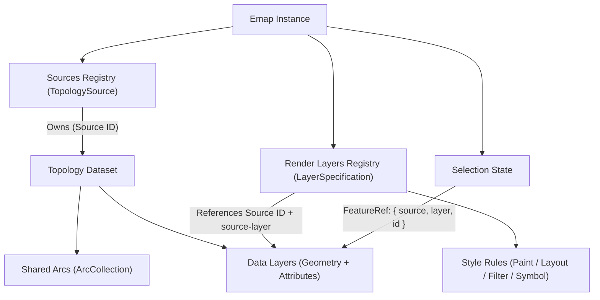

# Map and data model {#concepts-overview}

Emap strictly separates **spatial data storage**, **visual presentation**, and **interactive state**. This separation allows multiple visual styles (such as a polygon fill, an outline stroke, and text labels) to share a single underlying topology dataset while routing all data modifications through versioned, undoable edit commands.

## How core objects relate

An `Emap` instance coordinates workspace services. A `TopologySource` holds a topology dataset containing one or more **data layers** (geometry plus attributes). A `LayerSpecification` (**render layer**) references a source ID and an optional data-layer ID (`source-layer`) to define how that data is drawn:

Because presentation is decoupled from storage:

- Adding or removing a **render layer** (`addLayer` / `removeLayer`) changes only what is drawn on screen without altering the dataset.
- Removing a **source** (`removeSource`) removes the underlying dataset and affects every render layer referencing it. See [Sources and layers](./source-layer.md) for identifier rules.

## Coordinate spaces and feature identity

- **Project CRS vs. canvas pixels**: Dataset coordinates and camera centers use the map's active project CRS, while pointer events and hit testing use local canvas pixels. `map.project()` and `map.unproject()` convert between project coordinates and canvas pixels without altering data; `await map.reproject()` transforms dataset coordinates into a new CRS.
- **Positional `FeatureRef`**: A feature reference `{ source, layer, id }` identifies a feature by its zero-based index (`id`) inside a data layer (`layer`). Because splitting, merging, filtering, or replacing data can reindex features, store permanent business IDs in feature attributes and re-query them after structural operations.

## Read-only views vs. undoable mutation boundaries

- **Presentation and feedback**: Paint properties, display filters, selection (`map.select`), and hover highlights (`map.highlight`) change visual appearance without mutating dataset geometry or attributes.
- **Controlled data mutations**: Interactive editing handlers, `map.editSession`, `map.attributes`, and `map.ops` mutate data through workspace services that bump data versions, trigger redraws, and record `EditHistory` entries.
- **Never mutate `getDataset()` in place**: `source.getDataset()` returns a read-only live view of internal structures, not an isolated snapshot. Mutating its arrays directly bypasses version tracking, rendering invalidation, and undo history. Always use public editing APIs to modify data and `source.export()` to serialize files (see [Data formats](../data/formats.md)).

## Runtime extension and resource ownership

Every `Emap` instance owns an isolated Cordis `Context` (`map.ctx`). Built-in presets assemble services and plugins, and each plugin manages its own subscriptions and controls through Cordis Fibers. When your application passes an external shared `workerRuntime`, your application retains ownership and disposes that runtime after all maps using it have been disposed.

Next, read [Emap map instance](./emap.md) for lifecycle details, [Runtime composition](./runtime.md) for service injection, or jump to the [How-to guides](../guides/index.md).

## Runnable examples

- [Open a vector file](/mapseekai/emap/examples/getting-started/vector-file/)

## Implementation sources

- [`src/engine/map/map.ts`](https://github.com/mapseekai/emap/blob/master/src/engine/map/map.ts)
- [`src/domain/source/source.ts`](https://github.com/mapseekai/emap/blob/master/src/domain/source/source.ts)
- [`src/runtime/presets/index.ts`](https://github.com/mapseekai/emap/blob/master/src/runtime/presets/index.ts)
