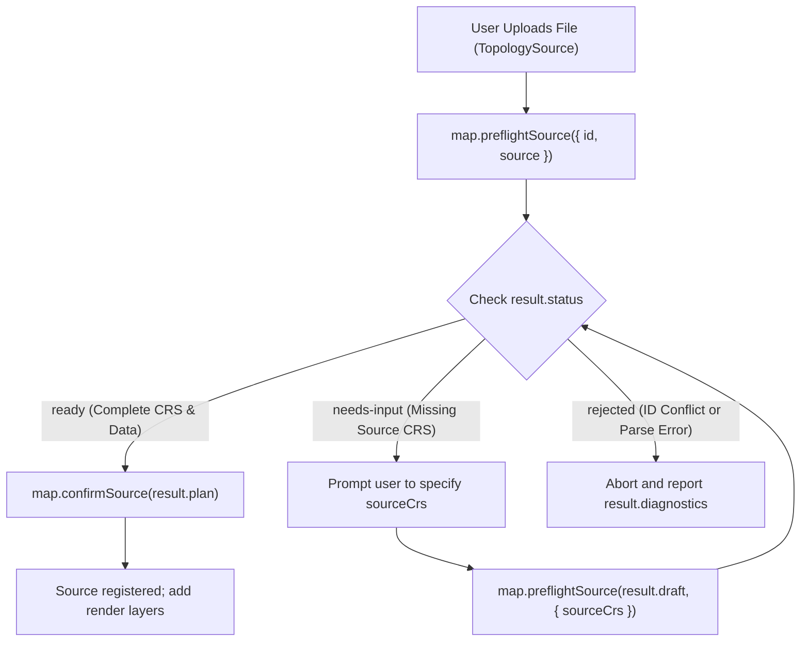

# Sources and layers

<span id="more-source-and-layer-ids" />
<span id="export-and-format-plugins" />

In Emap, a **source (`TopologySource`)** owns editable geometry and attribute tables, while a **render layer (`LayerSpecification`)** references that source and defines how it is drawn. Because data and presentation are separate, a polygon fill layer and a boundary stroke layer can share the exact same geometry in memory.

## Distinguish the three identifiers

Keeping these three identifiers distinct avoids the most common configuration errors:

| Identifier | Example | Where it is used |
| --- | --- | --- |
| **Map source ID** | `'districts'` | `map.addSource(id, source)`, render layer `source`, `map.ops` `{ source }`, `FeatureRef.source` |
| **Data-layer ID (or name)** | `'districts'` | Render layer `'source-layer'`, `map.ops` `{ target }`, `FeatureRef.layer`, `feature:click` filter `layers` |
| **Render-layer ID** | `'district-fill'` | `map.addLayer({ id })`, `setPaintProperty(id, ...)`, `setLayerVisibility(id, ...)`, `iterFiltered(id)` |

If you omit `'source-layer'` on a `LayerSpecification`, Emap defaults to the first data layer in that source. Whenever a file can contain multiple data layers (such as TopoJSON, GeoPackage, or multi-layer archives), specify `'source-layer'` explicitly rather than relying on import order.

## Load a source and add a render layer

Parsing a file creates a detached `TopologySource`. Registering it on the map with `await map.addSource()` makes it available to render layers:

```ts
import { TopologySource } from '@mapseekai/emap';

const source = await TopologySource.fromUrl('districts', '/data/districts.geojson');
await map.addSource('districts', source);
map.addLayer({
  id: 'district-fill', type: 'fill', source: 'districts',
  paint: { 'fill-color': '#47b878', 'fill-opacity': 0.5 },
});
const bounds = source.getExtent();
if (bounds.hasBounds()) map.fitBounds(bounds, { padding: 24, duration: 0 });
```

See [Data formats](../data/formats.md) and [File import](../recipes/file-upload.md) for format plugins and byte/ZIP resource limits.

## Preflight CRS before registering user files (`preflightSource`) {#confirm-crs-while-loading}

When importing user-supplied files that might lack CRS metadata or need reprojection to match the map's CRS, use `map.preflightSource()` **instead of** calling `map.addSource()` directly. Handle all three returned status branches:



```ts
const result = await map.preflightSource({ id: 'districts', source });
if (result.status === 'ready') {
  await map.confirmSource(result.plan);
} else if (result.status === 'needs-input') {
  console.log(result.draft, result.requirements);
} else {
  console.error(result.diagnostics);
}
```

- **`'ready'`**: Pass `result.plan` to `await map.confirmSource(result.plan)` to complete registration. A `ReadySourceLoadPlan` is bound to that map instance and can only be confirmed once; if map or source state changes before confirmation, run `preflightSource()` again.
- **`'needs-input'`**: Prompt the user for the missing information (such as `{ sourceCrs }`) and resubmit `result.draft` to `map.preflightSource(result.draft, { sourceCrs })`.
- **`'rejected'`**: Inspect `result.diagnostics` (for example, `source-id-conflict` or `source-crs-invalid`) and report the error.

## Replace data, update styles, and remove layers or sources

- **External data replacement (`source.setData()`)**: Replaces the dataset inside an existing source. Because feature counts and order can change, discard old `FeatureRef` indexes and re-inspect `source.getLayers()`.
- **Style vs. data removal**: Use `setPaintProperty()` and `setLayerVisibility()` to adjust appearance, `removeLayer()` to remove a visual presentation layer, and `removeSource()` when the underlying dataset itself is no longer needed.
- **Export (`source.export()`)**: Serializes current source data into a `Blob` without writing back to the original file on disk.

## API

<span id="core-methods" />
<span id="layerspecification" />
<span id="more-source-options" />
<span id="more-layer-styling" />

- [TopologySource](/mapseekai/emap/api/classes/emap.TopologySource.html)
- [LayerSpecification](/mapseekai/emap/api/types/emap.LayerSpecification.html)
- [ExportOptions](/mapseekai/emap/api/interfaces/emap.ExportOptions.html)

## Runnable examples

- [Open a vector file](/mapseekai/emap/examples/getting-started/vector-file/)
- [Line layers](/mapseekai/emap/examples/getting-started/lines/)
- [Point layers](/mapseekai/emap/examples/getting-started/points/)
- [Merge layers](/mapseekai/emap/examples/merge-layers/)

## Implementation sources

- [`src/domain/source/topology-source.ts`](https://github.com/mapseekai/emap/blob/master/src/domain/source/topology-source.ts)
- [`src/engine/map/source-loading.ts`](https://github.com/mapseekai/emap/blob/master/src/engine/map/source-loading.ts)
- [`src/engine/map/layer-registry.ts`](https://github.com/mapseekai/emap/blob/master/src/engine/map/layer-registry.ts)
